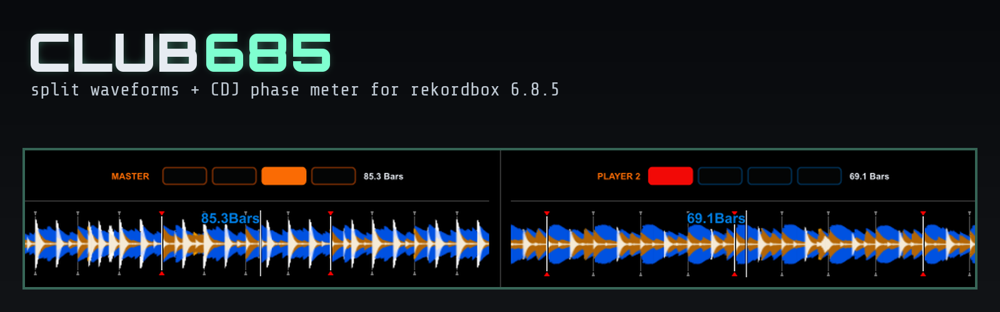
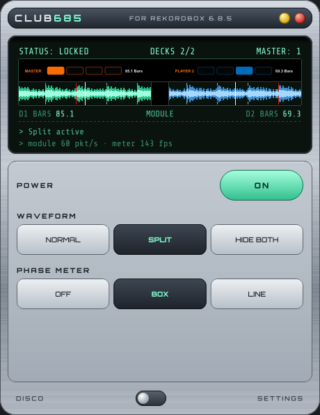

  

<h1 align="center">CLUB685</h1>

  <b>Split waveforms and a CDJ-style phase meter for rekordbox 6.8.5. Mix by ear.</b>

  
  
  
  
  
  

  

---

rekordbox stacks the two decks' waveforms on top of each other, so you end up beatmatching with your eyes. CLUB685 puts them side by side like two players in a booth and adds a CDJ-style phase meter above them. If you want to train your ears properly, it can hide the waveforms and leave only the meter.

  

## What it does

The WAVEFORM button picks how rekordbox's waveforms look:

- Normal leaves rekordbox as it is.
- Split shows both zoomed waveforms next to each other, each centred on its own playhead.
- Hide Both blacks them out.

The PHASE METER button adds the meter in Split or Hide Both:

- Off shows no meter.
- Box shows four beat blocks per deck with beat 1 in red, the master deck on top and the current bar beside it.
- Line shows a beat ruler that slides past a fixed playhead.

## Install

1. Download the ZIP from [Releases](https://github.com/314159DD/club685/releases/latest) and extract it.
2. Close rekordbox.
3. Run `Start CLUB685.cmd`.
4. Click INSTALL once and allow the Windows prompt. This copies the CLUB685 module into the rekordbox folder.
5. Start rekordbox, load two decks and pick a waveform and meter.

You need rekordbox 6.8.5 in the 2Deck Horizontal layout and Windows 10 2004 or newer.

---

MIT licensed. rekordbox is a trademark of AlphaTheta Corporation. CLUB685 is not affiliated with or endorsed by AlphaTheta.

